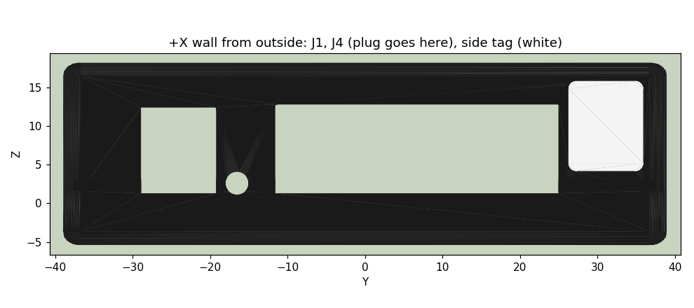
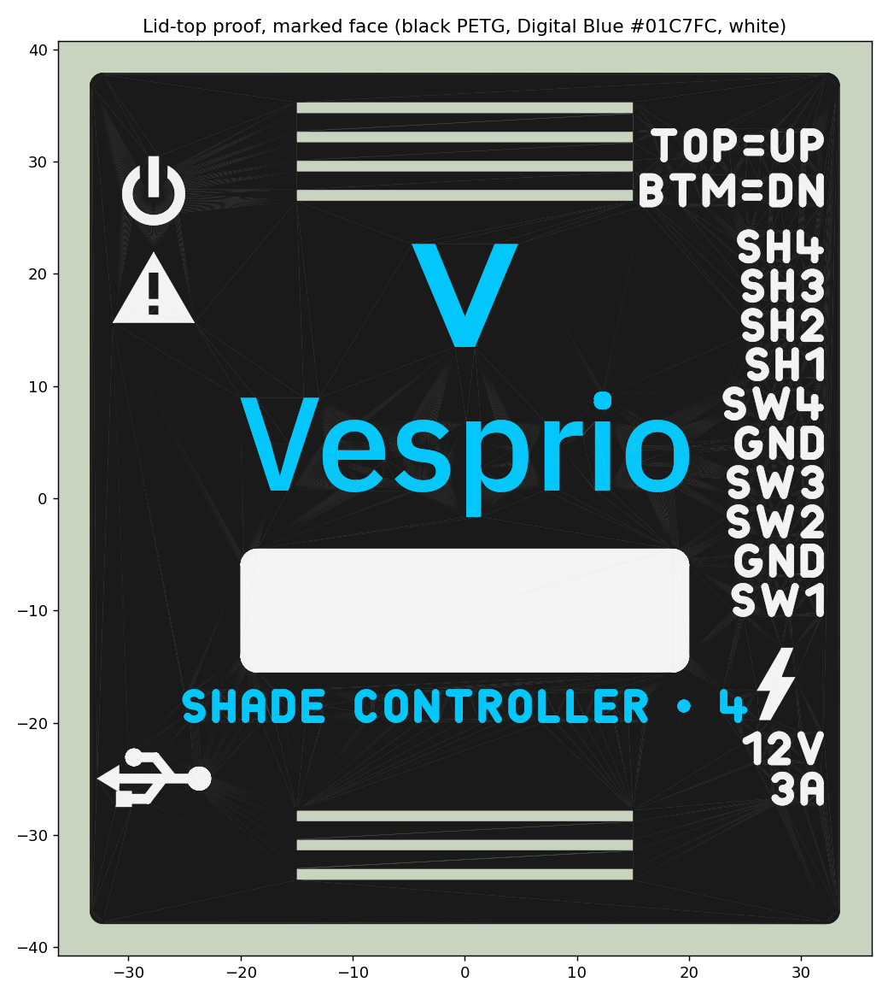

# Enclosure Rev 3 (for the Rev 1.3 board)

Spreadsheet-driven FreeCAD 1.1 model, generated by script (ADR-021).

| File | What it is |
|---|---|
| `project-case-rev3.FCStd` | The model. Open it, edit the **Params** spreadsheet, and press Recompute. |
| `build_case_rev3.py` | Builds the `.FCStd` from scratch using the `DEFAULTS` table. Re-running it overwrites spreadsheet edits. |
| `check_case_rev3.py` | Fit gate: feature health, markings printable, interference/clearance vs the board STEP, parameter-robustness pass, STL + PNG export (each STL must be a closed mesh). Run after every change; it takes about 20 minutes. |
| `build_lid_proof.py` | The lid-top proof print: the top 1.2 mm of the real lid with its inlays (see "Inlay test tiles and the lid proof" below) |
| `exports/` | `project-case-rev3-bottom.stl`, `project-case-rev3-lid.stl`, the lid's two inlays `-lid-inlay-brand.stl` / `-lid-inlay-labels.stl`, the white side tag `-side-tag.stl`, and `lid-proof-{base,blue,white}.stl` |
| `art/`, `svgpaths.py`, `marks.py` | Brand SVGs (copied from the Vesprio identity folder), the SVG reader, and `marks.py`: the monoline lettering, icons, and the printability check |
| `renders/` | Preview PNGs written by the checker |

```bash
FC=~/Apps/freecad-1.1.4/usr/bin/freecadcmd     # FreeCAD 1.1.4 AppImage, extracted
$FC enclosure/rev3/build_case_rev3.py           # only to rebuild from DEFAULTS
$FC enclosure/rev3/check_case_rev3.py           # always, after any change
$FC enclosure/rev3/build_lid_proof.py           # lid-top proof print, after the checker passes
```

## Model layout

- Origin is the **board centre**, and z = 0 is the **board's underside**.
- **+X wall**: terminal block J4, barrel jack J1, blue LED D5.
- **−X wall**: Micro-USB J2, LEDs D3 (red) and D4 (white).
- **+Y**: the board edge nearest the ESP32 antenna. On a wall, +Y is up: the keyhole slots run toward +Y.
- **Bodies**:
  - `Bottom` (tray) runs from the floor up to the board top, where the case splits.
  - `Lid` runs from the split line up.
  - `Board_Rev1_3` is a reference solid for viewing only. Hide it before exporting by hand.
  - `TrayPrint` / `LidPrint` are the bodies minus the markings: **these are what
    gets printed**. `InlayBrand` / `InlayLabels` are the lid's coloured inlays.
    The `Mark*` objects are the markings; their positions are spreadsheet
    expressions, but their text and sizes are set in `build_case_rev3.py`.

Assembly: the board sits on the tray's four corner standoffs. Four M3 screws
go in from underneath, through the counterbored tray holes and the board, and
self-tap into the lid posts. That is the same scheme as Rev 2.

## Where the defaults come from

All measured on 2026-10-12, from the as-fabbed PCB and the board STEP:

| Feature | Rev 1.3 measurement | Rev 3 default |
|---|---|---|
| Board | 65.004 × 73.935 mm, R3 corners | inner cavity +0.25 mm each side |
| Lid post holes | Ø2.8, what Rev 2 printed with (its notes said 2.9; 2.8 is right) | Ø2.8 |
| Tongue (ridge) | Fit print 1 had Rev 2's 0.55 wide × 0.5 tall: it barely engaged | 0.9 wide × 1.5 tall, 0.3 chamfer, centred in the wall; groove 1.2 × 1.7 |
| Mounting holes | x −28.913 / +29.034, y +33.370 / −33.401 | posts and standoffs on the holes |
| J4 header | crosses the +X wall at y −11.20…+24.60, z up to 12.40 | cutout 36.6 wide, to z 12.8 |
| J4 plug (1790182) | outside the wall; tops out at z 13.65 | clears the 15.94 ceiling |
| J1 barrel jack | 9.3 wide in the wall, centre y −24.06 | 9.7 × 10.8 cutout (Rev 2's 9.0 was narrower than the jack) |
| J2 Micro-USB | shell 7.4 × 2.31, centre y −24.96, z 2.745 | 8.4 × 3.3 slot plus a 13 × 8 outer recess, 1.5 deep |
| D3 / D4 / D5 | y +18.59 / +27.41 (−X), −16.53 (+X) | Ø3 windows, 1 mm above the board top |
| Side mount | −X wall (lid), terminal block faces out | 1 clip, holes along Y at y +5, z 10, bosses inside (ADR-022) |
| Underside parts | deepest −2.50 (U1 pins), floor at −3.15 | keyholes and DIN bosses placed in clear areas; keyhole cap top at −1.75 |
| DIN clips (2×) | USA 10 or generic 42.6 × 10 copy: 3 holes, 12.5 pitch (25 across the outer two) | Ø2.75 through 2.5 floor + 1.5 boss; clips at y −8 and +31 (ADR-022) |

## Known limits

- **USB plug reach.** The Micro-B receptacle face is 2.24 mm inside the outer
  wall. The 1.5 mm outer recess leaves about 0.7 mm for the plug to clear;
  test-fit it with the actual cable.
- **Keyholes are closed from inside**, as in Rev 2: a 0.6 mm cap (`kh_cap_t`)
  covers each head channel, so a wall screw or nail head can't reach the board
  underside. The head slides in a closed channel **1.8 mm tall** (Rev 2: 0.9)
  and up to 7.5 mm across (the entry hole). The floor under the channel is
  1.5 mm (`kh_recess` 1.0), so set the screw with its head 1.5–1.8 mm off the
  wall, and use a head no taller than about 1.7 mm (a low pan or wafer head). The checker probes both keyholes
  and fails if either is open from inside. (The first fit print, sliced
  before this change, has open keyholes.)
- **DIN clip screws** get 4 mm of engagement (2.5 floor + 1.5 boss). Length =
  clip base thickness + up to 4 mm; measure the clip. The case stands off the
  rail by less than the clip's 19.3 mm height (the rail sits inside the clip).
- **No text on the walls.** Rev 2's side text didn't print legibly: walls
  print layer by layer, and the flat wall above J4 is only about 3.5 mm tall.
  All markings are on the two faces that print on the bed (below). The one
  thing on a wall, the white side tag, is a separate plate printed flat.

## Markings

Both marked faces print on the build plate (the lid prints top-down), which
is the sharpest surface an FDM print has. The checker fails if a marking runs
into a vent, onto the edge fillet, or into a keyhole, or overlaps another.

**What the printer resolves** (test tile v2, 2026-10-15, black PETG, 0.4
nozzle): a **0.6 mm** line prints clean and a **0.5 mm** gap stays open; 0.5
lines and 0.4 gaps don't. `marks.printability()` rasterises every marking and
fails anything a 0.6 mm pen can't draw or a 0.5 mm pen can't get between
(`MIN_STROKE`, `MIN_GAP` in `marks.py`); the checker runs it on every mark.
Sharp corners are allowed up to 0.35 mm of rounding, and the V-shaped crotch
inside one letter (N, W, M, V) is the letter's design, not a fault.

**Lettering is monoline** (`marks.mono_text`): single strokes 0.64 mm wide
with round ends, counters and letter gaps built to at least 0.54 mm, upper
case only. DejaVu Bold at the 3 mm these labels can have (the J4 rows are
3.5 mm apart) has sharp stroke ends and 0.14–0.4 mm gaps, and blurred on the
tile. Only the brand lockup still uses outlines; it prints fine at its size.
A glyph is drawn as centre lines; an open line must not run back onto itself
(draw a stem as its own stroke), or the offset leaves a hole there.

**Lid top**: flush inlays, 0.6 mm (3 layers) deep. Read with +Y up (wall mount).

| Marking | Inlay | Where |
|---|---|---|
| Vesprio stacked lockup (no tagline) | brand | centre, 40 mm wide |
| `SHADE CONTROLLER • 4`, monoline, 3 mm caps | brand | lower centre |
| J4 legend `SW1 GND SW2 SW3 GND SW4 SH1 SH2 SH3 SH4`, monoline 3 mm, one per column, pin 1 at the jack end; `TOP=UP / BTM=DN` above | labels | +X edge, beside each column |
| `12V 3A` (monoline 3 mm) and a lightning bolt with flat-cut tips (D5, 12 V motor power) | labels | +X edge, at J1 and D5 |
| Power symbol (D4), warning triangle (D3 status), USB trident (J2), all at 1.4× (`icon_k`) | labels | −X edge, level with each part |
| Write-on panel, 40 × 11 mm, plain white | labels | centre, between the logo and `SHADE CONTROLLER • 4` |

**Write-on panels** say what each unit drives ("OVERHEAD", "WINDOWS") in
black marker, which wouldn't show on the black case. There is one on each face
that can face out:

- **Lid top panel** (above): faces out on a wall (keyholes) and on a rail
  mounted flat (the two clips on the tray).
- **Side tag** on the +X wall, beside the J4 plug: faces out on a side rail
  mount (the clip on the −X wall). It's a 9.6 × 11.6 × 0.6 mm white plate,
  `project-case-rev3-side-tag.stl`, in a 0.6 mm pocket with 0.1 mm clearance.
  It isn't an inlay because the wall prints layer by layer: a white patch
  there would mean two filament swaps on each of about 60 layers. Print the
  tag flat in the lid job (below) and glue it in with a drop of CA (superglue)
  or a square of thin double-sided tape. Write on it before or after, either way.



A black Sharpie on the white PETG works well (tested on tile v1). It
survives handling and comes off with alcohol, which makes relabelling easy.

The lockup's own tagline ("CRAFTED HOME SYSTEMS") prints at 0.2–0.3 mm
strokes at this size, below what a 0.4 nozzle can lay down. So the lid uses
the no-tagline lockup, and `SHADE CONTROLLER • 4` takes the tagline's place.
"TOP" means the lid side: on J4 the row nearer the lid (pins 1–10) is UP and
the row nearer the floor (11–20) is DOWN (ADR-011).

**Tray underside**: 0.6 mm debosses, single colour, mirrored so they read from outside:
the monogram between the keyholes, and `VSP-WSC-4` / `REV 1.3` /
`(C) 2026 VESPRIO.IO` (monoline; a © can't be drawn within the printer's
limits at this size) below the lower DIN clip. Change the revision text in
`UNDER_LINES` in the builder.

**Top vents** are two bands of 30 × 1 mm slots, to clear the centre for the
logo: four over U7/U11/U8 (the hottest parts) and three over U1. On a wall the
lid faces out, so these are low and high openings in a vertical face. The
side vents on the ±Y walls (top and bottom edges on a wall) do the chimney work.

### Colours and material

| Part | Colour |
|---|---|
| Case | black (matte black PLA hides layer lines best) |
| Brand inlay | Creality CR-PETG Digital Blue, #01C7FC (about 10:1 contrast on black; royal blue is about 3.5:1). Get the opaque spool, not "Transparent Blue". The brand file's own colour is #0B1220, a near-black navy that would vanish on black. |
| Labels inlay | white: highest contrast for the small text |

**PLA or PETG.** The barn isn't climate-controlled, and PLA starts to soften
around 55–60 °C. Inside the case it runs about 15 °C above room temperature
under load (measured on the bench). A PLA case hanging on keyholes in a hot
barn can creep. PETG is the safer choice for the installed units, and a PLA
print is fine for fit tests. Don't mix PLA inlays into a PETG case: the two
barely bond to each other (PETG is sold as a support interface for PLA for
that reason), and the inlays could flake off. So the barn lids are black
PETG with Digital Blue and white PETG inlays. Print the lid proof first.

### Printing the lid in three colours (Bambu Studio)

1. **Import** `project-case-rev3-lid.stl`, `project-case-rev3-lid-inlay-brand.stl`
   and `project-case-rev3-lid-inlay-labels.stl` together (select all three in
   one Import), and answer **Yes** to "load as a single object with multiple
   parts". The inlays fill their pockets exactly.
2. In the object list, set the filament per part: lid black, inlay-brand blue,
   inlay-labels white.
3. **Lay on face**: click the lid's outer top face, so it goes on the bed with the inlays.
4. **Process settings**: Quality → **Elephant foot compensation = 0** (the
   default 0.15 mm shrinks every layer-1 outline, which is where the markings
   are) and Quality → **Wall generator = Arachne**.
5. Slice. The colour changes happen only in the first 3 layers, so purge
   waste is small. Turn on "Flush into objects' infill" to cut it further.
   Check layer 1 in the preview: logo, tagline, labels, icons and the
   write-on panel all visible.
6. A textured PEI plate gives the top a matte texture, and a smooth plate gives
   a gloss. Either way, keep the plate clean for the first layer. Matte takes
   marker better.
7. **Side tag**: import `project-case-rev3-side-tag.stl` as its own object
   (not a part of the lid), set it to white, and Lay on face on one of its
   big faces. It's 3 layers, all inside the lid's colour layers, so it adds
   no filament swaps. Print a spare; it's a fraction of a gram.
8. **Send print**: check the AMS mapping in the send dialog. Each slicer
   filament (1, 2, 3) is matched to an AMS slot, and with three "Generic
   PETG" profiles it can map white to the blue slot. Click each one and pick
   the slot that holds that colour.

The tray prints as before, floor on the bed. Its debosses are in the first 3 layers.

### Inlay test tiles and the lid proof

**Tile v1 (2026-10-14)**, swatches at three depths plus samples at true size:
- 0.6, 0.8 and 1.0 mm inlays looked the same in both colours, so `mark_d`
  stays 0.6.
- The Vesprio wordmark printed fine, and black marker works well on the white.
- The labels, `TOP=UP`, the tagline and the icons were blurry, and the bolt
  kept only its middle. The causes were Elephant foot compensation (it shrinks
  every layer-1 outline) and gaps between letters as narrow as 0.14 mm.

**Tile v2 (2026-10-15)**, with Elephant foot compensation 0 and Arachne:
- Line ladder: 0.6 mm is the first clean line. Gap ladder: 0.5 mm is the
  first open gap. These are `MIN_STROKE` / `MIN_GAP`.
- DejaVu Sans Bold at 3 mm read best of three label versions but was still
  soft (its letter gaps are 0.39 mm). Icons at 1.4× were good; the bolt's
  tips were still unclear. The bold tagline was readable but not crisp, and
  the small one's "4" blurred.

That led to the monoline lettering, 1.4× icons and the flat-tipped bolt, all
checked by `printability()`. Both tile scripts are in git history
(`build_test_tile.py`).

**Lid proof** (`build_lid_proof.py`): the top 1.2 mm of the real lid, with its
inlays, about 8 g. It's sliced from the model, so it is exactly what the lid
will look like. Print it like the lid (steps above, including the Process
settings and the AMS check): import `lid-proof-base.stl`, `-blue.stl` and
`-white.stl` together as one object, black / Digital Blue / white, Lay on face
on the marked face.



## Fit print 1 results (2026-10-13)

- **Board fit: perfect.** No dimension changes.
- **Tongue didn't lock into the groove.** It was 0.55 wide (one extrusion
  line) and 0.5 tall with a 0.25 chamfer, so only about one layer of straight
  side engaged. Now 0.9 wide × 1.5 tall (`ridge_w`, `ridge_h`), 0.15
  clearance each side, groove 1.7 deep. That leaves 0.65 mm of lid wall on
  each side of the groove. Side vents moved up (`sv_z0` 2.5) to clear the
  deeper groove.
- **Most vents missing.** It was a model bug, not a print problem. FreeCAD 1.1
  doesn't move a body's Tip to a new LinearPattern, so the lid ended at the
  first slot of each row. `build_case_rev3.py` now sets the Tip, and the
  checker fails if a body's Tip isn't its last feature or if any vent slot is
  blocked. Expect 6 top slots and 6 in each Y wall.

## Test print (fit check)

Bambu Studio settings for a fit-test print. The goal is true dimensions with
minimal filament, since the part gets thrown away.

**Filament.** The two parts are about 41 cm³ solid, roughly 35–45 g at these
settings. Check the slicer's gram estimate against the AMS slot's remaining %.
If the spool is tight, print from another slot: colour doesn't matter for a
fit test. AMS filament backup (auto-refill) only switches to a slot it treats
as the *same* filament, meaning the same type and colour set on the slot (and
on some firmware, the same brand). Don't rely on it unattended unless the
backup slot's settings match.

| Setting | Value | Why |
|---|---|---|
| Process | 0.20 mm Standard | 0.28 draft distorts the tongue and groove (0.15 mm clearance) |
| Wall loops | 3 | realistic screw bosses and posts |
| Sparse infill | 10 % gyroid or grid | fit doesn't depend on infill |
| Supports | off | not needed with the orientation below |
| X-Y hole / contour compensation | 0 | measure the model as-is; fix sizes in the spreadsheet, not the slicer |
| Elephant-foot compensation | default (0.15) | |
| Speed | Standard | Sport/Ludicrous cost accuracy |
| Brim | off | |

**Orientation.**
- `project-case-rev3-bottom.stl`: as imported, floor on the bed.
- `project-case-rev3-lid.stl` (with its two inlays as parts, see Markings): **flipped**, outer top face on the bed ("Lay on face"), so the rim, groove and posts print upright.
- `project-case-rev3-side-tag.stl`: flat, white, beside the lid.

Before leaving it running: scrub the slice preview at the tray's top layers
and the lid rim (tongue and groove visible, no support warnings), and turn on
first-layer inspection, spaghetti detection and runout detection.

**Check, in this order:**
1. Board seats on the four corner standoffs.
2. Lid closes. Tongue and groove engage without force and keep the lid from shifting sideways; J4 (with the plug in) and J1 sit in their openings.
3. M3 screws: the tray holes clear them, and the lid posts self-tap without splitting.
4. A Micro-USB cable plugs fully through the recess (tightest margin).
5. DIN clips: screws go in; measure the clip base thickness and its stand-off with a rail in it.
6. LED windows line up with D3/D4 and D5.
7. The side tag drops into its +X wall pocket flush, without forcing, and the J4 plug still seats beside it.

Record what's tight or loose (and by how much). Then change the **Params**
spreadsheet and re-run `check_case_rev3.py`.
